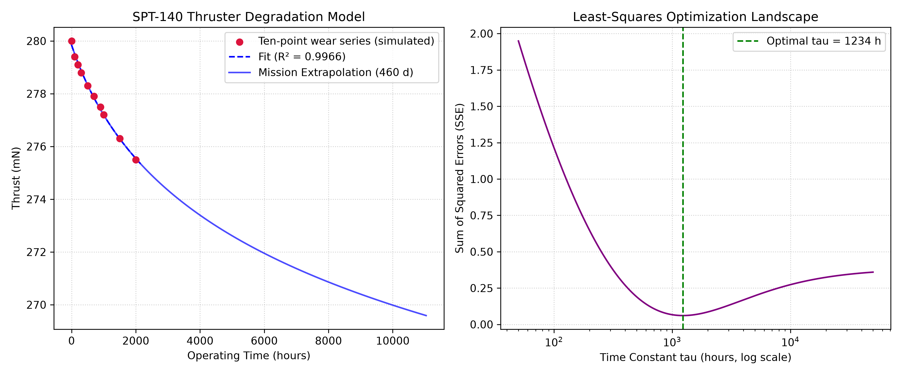
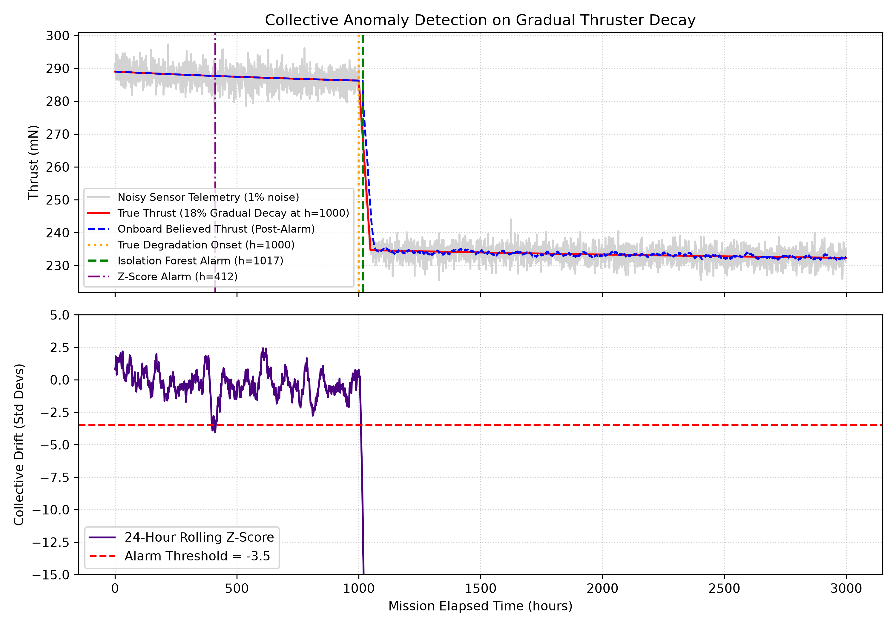
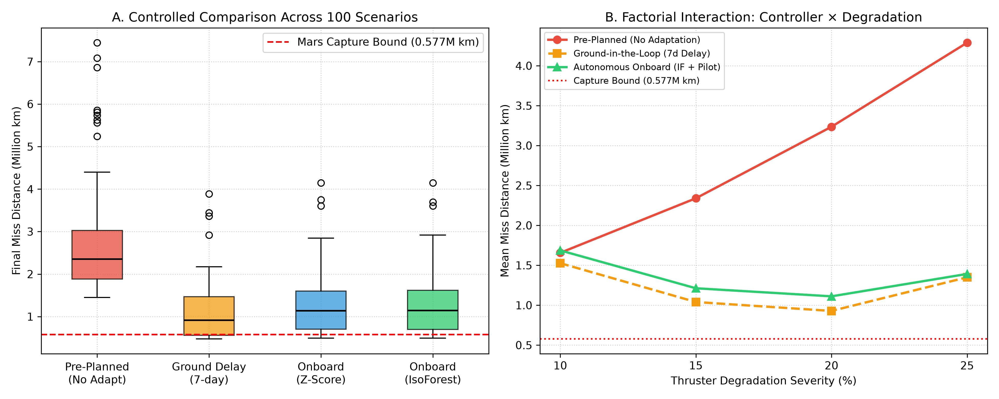
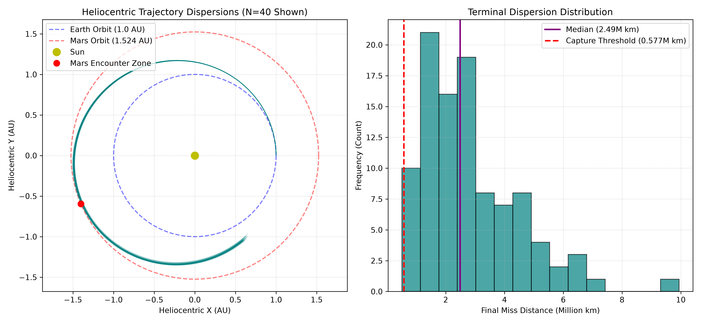

# Detect, Then Steer: An Onboard Flight Director for Progressive Hall-Thruster Degradation on Earth–Mars Transfers

**Abstract.** Solar-electric Mars trips carry a special risk: the engine can lose thrust over weeks instead of failing at once, so a spacecraft that cannot recognize the decline follows a plan built for an engine it no longer has. Can a detector trained without labels, plus a small neural-network policy, form an onboard flight director cheap enough for flight computers? We build a 460-day, three-dimensional simulation of an SPT-140-class transfer, fit a logarithmic wear law to a ten-point wear series ($R^2 = 0.997$), and test three detectors on 50 degraded and 50 healthy streams. A collective Isolation Forest reaches $F_1 = 0.990$ with no false alarms and fires 20.5 h after onset; a z-score reaches 0.959 and fires 6.8 h earlier. Closing the loop over 100 fault cases cuts the median miss from 2.35 to 1.14 million km (51.5%) for 46 kg of propellant and lifts capture from 0% to 15%; the reduction holds at 52–67% across five retrainings, though the open-loop baseline moves between 2.35 and 4.84 million km. A 3 × 4 experiment shows the gain over a fixed plan growing with severity, from none at 10% to 3.2 million km at 25%. A seven-day ground replan edges out the onboard loop (0.91 against 1.14 million km), but the ordering reverses in one of five seeds and follows the plan draw more than the controller, so it remains unresolved and the case for autonomy rests on availability. One decision costs 1.9 μs and 1.9 KB, far inside a 12-hour cycle. With the full disturbance stack the mean miss rises to 2.85 ± 1.67 million km and capture falls to 3%, no better than the fixed plan's clean mean of 2.72 million km. The limit is training range, not computer speed.

## 1. Introduction

Mars is four to twenty light-minutes away, so a ground team cannot watch a thruster degrade in real time or intervene inside a communications round trip; the loop that keeps a solar-electric craft on target must close on board. A Hall thruster delivers a few tenths of a newton for months; its failure signature is not an alarm but a slow erosion of the thrust-to-power ratio as the discharge channel wears (Snyder et al., 2019). By the time a fixed threshold trips, the spacecraft may have spent weeks thrusting a trajectory that no longer matches its engine.

Two research communities have worked on neighboring halves of this problem. Telemetry work shows unsupervised models can flag spacecraft anomalies without labels (Hundman et al., 2018), that a tree-based method called Isolation Forest isolates unusual readings using little memory (Liu et al., 2008), and that feature extraction plus multi-task learning works on real satellite data (K. Yang et al., 2022). Guidance work shows reinforcement learning can fly low-thrust Earth–Mars transfers (Miller et al., 2019; Zavoli & Federici, 2021), adapt to changing dynamics (Casas et al., 2022), and survive engine failures when given memory (Gaudet et al., 2020b). Neither group connects the other's loop. Detectors are scored on precision and recall, not on the trajectory their alarms save; policies are trained against faults injected as sudden, random losses, which is not how a Hall thruster dies.

**Research questions and hypotheses.** This study asks whether a lightweight onboard detector–policy pair can turn progressive Hall-thruster degradation into a smaller final miss without exceeding a flight computer's budget. RQ1 asks whether a collective detector catches progressive faults more reliably than a point-only baseline without false alarms. RQ2 asks whether closing the loop reduces final miss relative to a fixed plan, and how much a seven-day ground delay costs. RQ3 asks whether the policy fits a 12-hour guidance cycle. We expected windowing to improve detection, closed-loop control to reduce miss, and the policy to fit the budget.

Our contributions are four. We pair a 24-hour collective Isolation Forest with a 243-parameter policy end-to-end, so detector quality is judged by the trajectory it saves, not by $F_1$ alone. We compare against a fixed plan and a seven-day ground strategy with the same detector, a comparison generous to the ground case. A 3 × 4 experiment varies controller and severity. Finally, we report a result that cuts against onboard control: on slow ramps over a 460-day transfer, a seven-day ground replan is about as good as the onboard loop (0.91 against 1.14 million km, with the ordering reversing in one of five training seeds), so the case for autonomy rests on availability and fast faults. Both controllers still beat their own run's plan in all five retrainings, the onboard loop by 52–67%.

## 2. Related Work

### 2.1 Detecting anomalies in spacecraft telemetry

Spacecraft telemetry is multi-channel, strongly correlated, and rarely labelled, which makes it a natural target for unsupervised detection. Hundman et al. (2018) trained one LSTM per channel — a network that remembers earlier readings — to predict the next value, then flagged large deviations with a threshold that adjusts to the data. Their one-model-per-channel design is also the limitation: interactions between channels, where a thruster fault lives, are left to simple thresholding. K. Yang et al. (2022) extract features with four related tasks and report accurate detection on real satellite data. Liu et al. (2008) supply the algorithm: random binary trees separate unusual points after few splits, using little memory and run time linear in data size.

Chandola et al. (2009) separate point, contextual, and collective anomalies; slow equipment drift is collective, because each hourly reading looks normal while the sequence is diagnostic. Ballentine et al. (2026) address the other shortage — too little real flight data — by learning a physics-informed generative model that synthesizes training trajectories; we train on healthy data alone, which avoids labels but inherits the simulation-to-flight gap in Section 7.

### 2.2 Reinforcement learning for low-thrust guidance

Most recent guidance work uses reinforcement learning with continuous actions: a real-valued throttle and steering angle. Miller et al. (2019) trained Proximal Policy Optimization (PPO) agents to fly fuel-efficient Earth–Mars transfers on realistic planet-position models and found they approach NASA's standard trajectory optimizer at interplanetary scale. Zavoli and Federici (2021) randomized small disturbances across many simulated trials and showed that a PPO policy keeps its targeting accuracy when the environment differs from training. Sullivan and Bosanac (2020) compared three reward designs for a low-thrust orbit approach.

Reward design is the main tuning knob. Sullivan et al. (2021) split the reward into progress and propellant terms, avoiding the hard tuning a single score needs. Gaudet et al. (2020a) used a short horizon for steering hints and a long one for touchdown, landing a simulated vehicle on Mars under noise. Federici et al. (2023) showed that a general-purpose reward, without hand-tuned shaping, finds fuel-efficient Earth–Moon transfers. H. Yang et al. (2024) build stability requirements into the guidance rule and keep targeting accuracy under uncertainty during asteroid approach. Chaudhary et al. (2026) move closest to operations, adding a learned correction to an existing multi-burn plan and testing 100,000 simulated Earth–Mars runs.

Two gaps remain. Faults are modeled as sudden, random losses rather than steady wear that builds over days, and the policy is tested alone, without the detector that must notice the fault first. Gaudet et al. (2020b) give a recurrent policy memory so it adapts to random engine failure, and Casas et al. (2022) show that an agent which does not assume exact dynamics can handle uncertainty, but both estimate degradation indirectly and neither reports when the estimate becomes reliable. This study fills that gap by coupling a collective detector to a guidance policy and scoring the pair on final miss.

### 2.3 Onboard autonomy, compute, and verification

Onboard learning must fit, run fast enough, and be trustworthy. Izzo et al. (2019) survey the shift from evolutionary optimization to deep reinforcement learning in spacecraft guidance. Cheng et al. (2019) replace repeated optimization with trained networks that return commands in real time. Elkins et al. (2020) turn a spacecraft through large angles accurately without a high-performance computer, and Getzandanner and Martin (2025) learn a navigation policy that also characterizes its environment.

Embedded tests are stronger evidence. Capra et al. (2025) pair a PPO planner with model-predictive control to enforce safety limits; on a Raspberry Pi 4 the pipeline runs about ten times slower than on a laptop but still finishes in seconds. Capra et al. (2023) support two choices we adopt: continuous actions beat fixed on/off choices, and recurrent networks train more stably when the agent cannot see the full state. Izzo et al. (2021) show that stability theory can prove a trained state-feedback network recovers from disturbances, so a neural controller need not be a black box.

### 2.4 Hall-thruster degradation

Snyder and Hofer (2014) measured the SPT-140 at different power settings. Snyder et al. (2018) tested it from 0.9 to 4.5 kW in vacuum, establishing baseline thrust and efficiency and showing how chamber pressure shifts them. The SPT-140 life test lost about 8% of thrust at 4.5 kW over the first 2,000 h, then stayed roughly constant to 10,000 h (Snyder et al., 2019). Degradation is a trend, not an event. A thruster can lose thrust for two reasons — a lower commanded throttle or wear — and a detector must separate them. Our simulator starts from the SPT-140's nominal performance and models wear as a logarithmic decay fitted to synthetic data. The detector therefore compares each reading with an expected curve, not a constant.

## 3. Mission Model and Problem Formulation

The spacecraft starts at Earth's position, 1 AU from the Sun, with Earth's orbital velocity plus a 2.0 km/s boost. It must reach Mars' sphere of influence, modeled as a 577,000 km capture radius, within 460 days. Mars follows a tilted circular orbit at 1.524 AU with a 1.85° inclination. We fix its start so a 130-day thrust arc meets the orbit near day 290. The simulation includes only the Sun's gravity and steps forward in 12-hour chunks with semi-implicit Euler for 920 steps. This is not a high-precision ephemeris; see Section 7.

The thruster is an SPT-140-class device with nominal thrust $T_0 = 0.289$ N and specific impulse $I_{sp,0} = 1782$ s. Wet mass is 2747 kg; dry mass is 1648 kg. At full throttle the propellant flow is $\dot{m} = T_0/(I_{sp,0} g_0) \approx 1.65 \times 10^{-5}$ kg/s. Two factors multiply the nominal thrust. Aging follows

$$T(h) = T_0\left[1 - \frac{\kappa}{P_0}\ln\left(1 + \frac{h}{\tau}\right)\right],$$

where $h$ is hours, $P_0$ the baseline thrust of the wear series, $\kappa$ the wear size in newtons, $\tau$ sets how quickly it flattens, and the fault factor $f(h)$ uses onset $h_o$, severity $S$, and ramp length $r$:

$$f(h) = 1 - S \,\mathrm{clip}\left(\frac{h - h_o}{r}, 0, 1\right).$$

The clip function keeps the factor between 0 and 1. At throttle $u \in [0,1]$ (0 is off, 1 is full), delivered thrust is $u\,T(h)f(h)$, while propellant flow stays $u\dot{m}$. A worn thruster loses efficiency, not just authority: it spends the same propellant for less push.

The guidance problem is a fixed-length decision problem called a Markov decision process (MDP). At each step the policy sees 11 numbers: the spacecraft's position and velocity relative to Mars (six numbers, in a frame aligned with its orbit); its distance from the Sun; its speed toward or away from the Sun; the fraction of propellant left; the fraction of mission time left; and a health estimate. It returns a throttle $u = \mathrm{sigmoid}(o_0) \in (0,1)$ and two steering angles $\alpha, \beta = \frac{\pi}{2}\tanh(o_{1,2})$ that tilt the thrust in and out of the orbital plane; sigmoid and tanh keep the outputs in range. The reward is

$$J = -\log_{10}\!\left(\frac{\max(d_{\min}, 150{,}000\ \mathrm{km})}{577{,}000\ \mathrm{km}}\right) + 0.3\,\eta\,\mathbb{1}[\text{captured}],$$

where $d_{\min}$ is the closest approach and $\eta$ the propellant fraction remaining. The logarithm makes each factor-of-ten improvement worth the same, and fuel is rewarded only on capture, so coasting cannot pay.

## 4. Methods

### 4.1 Fitting the wear law

We fit Equation 1 to the simulator's ten-point thrust series from 0 to 2000 hours. The series is generated, not tabulated. It is written for the 4.5 kW operating point, close to the SPT-140 measurements of Snyder et al. (2018), and its shape follows the SPT-140 life test, at a deliberately smaller ~1.6% loss over 2,000 h (Snyder et al., 2019). Because the fit returns a wear fraction, $\kappa/P_0$, it carries over unchanged to the simulator's 289 mN nominal thrust. For a fixed $\tau$, the model is linear in $\kappa$, so a standard least-squares fit gives the best $\kappa$. We search $\tau$ on a logarithmic grid from 50 to 50,000 hours for the smallest squared error, then repeat for specific impulse. The fitted curves then give the expected thrust over the full 11,040-hour mission, which the detector uses as its baseline.

### 4.2 Three detectors

All detectors see hourly telemetry with 1% random noise on thrust and specific impulse, plus a solar-array temperature channel with no fault information, to test false alarms.

**Point-only Isolation Forest ($w=1$).** Raw [thrust, specific impulse, temperature] triples go to a 50-tree forest trained on the first 240 healthy hours; it expects about 1% of baseline hours to look unusual, and an alarm needs three flagged hours in a row. It sees only one hour at a time.

**Physics-informed z-score ($w=24$).** We compute the wear-corrected residual $e(h) = T_{\text{meas}}(h)/T(h) - 1$, estimate $\sigma_e$ from the first 240 hours, average $e$ over the last 24 hours (only past data), and form $z = \bar{e}/(\sigma_e/\sqrt{n})$. Averaging cuts random noise by $\sqrt{n}$, turning a 1% per-sample fluctuation into roughly 0.2%. An alarm requires $z < -3.5$ for three consecutive hours.

**Collective Isolation Forest ($w=24$).** Four summary numbers are computed each hour: the 24-hour average thrust and specific-impulse residuals, the change in the thrust residual over the window (scaled by 100), and normalized temperature. A 50-tree forest with a 0.5% contamination setting is trained on hours 24–240, which are healthy by construction. An alarm requires four flagged hours in a row and a 24-hour thrust residual below $-1.5\%$. This blocks false alarms from random upward spikes, the main problem during development.

After an alarm, every detector gives the same health estimate: the expected wear curve beforehand, the 24-hour average of measured/expected thrust afterwards, so detection cannot reveal the true severity.

### 4.3 The guidance policy and its training

The policy is a two-layer network: 11 inputs, 16 tanh hidden units, 3 linear outputs, 243 parameters (176 weights, 16 hidden biases, 48 output weights, 3 output biases). We train it with evolution strategies, which needs no gradients. Each random change is tested with its opposite (an antithetic pair) to reduce noise; each generation samples 64 pairs and tests all 128 versions on the same scenarios. Scores are ranked, converted to -0.5…0.5, and combined into the estimate

$$\nabla_\theta J \approx \frac{1}{2Ps}\sum_{p=1}^{P}\left(u_p^{+} - u_p^{-}\right)\epsilon_p,$$

where $u^{+}$ and $u^{-}$ are the rank scores of the better and worse member of each pair, $s$ is the step size, and $\epsilon_p$ is a random direction. Each parameter change is capped at $\pm 0.05$, borrowed from PPO (Schulman et al., 2017), which limits how far a policy can move in one update; without it, one bad update can ruin training. Using ranks rather than raw scores relates to Schulman et al. (2016) and Mnih et al. (2016): only relative performance matters. Stage 1 trains 400 generations on a healthy thruster; Stage 2 fine-tunes for 200 generations on faults that remove 10–25% of thrust, begin on days 30–150, and ramp over 24–72 hours, with the policy taking control at onset and receiving the true health value, so adaptation is tested separately from detection. Both stages finish in under two minutes on a laptop CPU.

### 4.4 Closing the loop

The nominal policy's commands on a healthy thruster are recorded as a 920-step open-loop plan. Four strategies are compared on identical fault cases:

1. **Pre-planned.** Follow the plan for the entire mission, ignoring the fault.
2. **Ground-in-the-loop.** Follow the plan until the detector fires, wait 168 hours for replanning and uplink, then hand control with the detector's health estimate.
3. **Onboard z-score.** Hand control to the policy at the z-score alarm.
4. **Onboard collective IF.** Hand control at the Isolation Forest alarm.

We deliberately favor the ground strategy: it gets the onboard alarm time and health estimate, so its only penalty is the 168-hour wait; a real team would also need a tracking pass and plan review.

### 4.5 Experimental design

Simulation gives known fault timing and severity, which real telemetry cannot, at the cost of realism (Section 7). The design is a controlled comparison, which changes one thing at a time, plus a factorial that tests every combination (Creswell, 2012; Leedy & Ormrod, 2015). The comparison holds launch state, fault set, and plan fixed while changing only the controller across 100 fault cases; onset, severity, and ramp ranges are in Table A1. The factorial crosses three controllers with four severities and uses 25 paired onset times per controller–severity combination, all on a fixed grid with a 48-hour ramp, so every controller sees the same faults. A separate 100-run Monte Carlo study adds the disturbances in Table A1, following Zavoli and Federici (2021). Finally, we time one policy decision over 10,000 calls after 100 warm-ups and count parameter memory directly.

## 5. Results

### 5.1 The wear law fits, and it extrapolates

The logarithmic model reproduces the synthetic thrust series almost exactly: $P_0 = 279.85$ mN, $\kappa = 4.46$ mN, $\tau = 1234$ h, $R^2 = 0.9966$. Specific impulse fits more tightly ($R^2 = 0.9996$, $\tau = 4142$ h). Extrapolating to 11,040 hours leaves about 96% of nominal thrust — a loss too small for any fixed threshold to notice but large enough to accumulate a multi-million-kilometer miss over 460 days.

*Figure 1. Ten-point synthetic thrust series, the fitted logarithmic law extrapolated across 460 days, and the sum-of-squares landscape in $\tau$ with its minimum near 1234 h.*

### 5.2 Collective windowing is what makes detection work

Table 1 reports the detector test over 50 degraded and 50 healthy streams. The point-only forest catches 19 of 50 faults (recall 0.38); its 8.8-hour delay is measured only on those catches, so the number flatters it. Adding window features changes the result: the z-score reaches $F_1 = 0.959$ with 94% recall and one false alarm, and the collective forest reaches $F_1 = 0.990$ with 98% recall and no false alarms.

**Table 1. Detector benchmark on 50 degraded and 50 healthy telemetry streams (240-hour healthy baseline).**

| Detector | Precision | Recall | $F_1$ | False alarms | Mean delay (h) |
| :--- | ---: | ---: | ---: | ---: | ---: |
| Point-only IF ($w=1$) | 0.950 | 0.380 | 0.543 | 1/50 | 8.8 |
| Physics-informed z-score ($w=24$) | 0.979 | 0.940 | 0.959 | 1/50 | 13.7 |
| Collective IF ($w=24$) | 1.000 | 0.980 | 0.990 | 0/50 | 20.5 |

The two detectors trade off differently: the z-score fires 6.8 hours sooner, the forest has the better $F_1$, and at a 12-hour cycle a few hours barely matter.

*Figure 2. Noisy telemetry with an 18% decay from hour 1000, the onboard health estimate after the alarm, both alarm times, and the 24-hour rolling z-score against the $-3.5$ threshold.*

### 5.3 Closing the loop cuts miss distance and lifts capture

Table 2 gives the controlled comparison over 100 fault scenarios. The open-loop plan misses by a median 2.35 million km. Every closed-loop strategy cuts that by half or more: 0.91 million km for the ground-delayed strategy (61.1%), 1.13 for the z-score (51.8%) and 1.14 for the collective forest (51.5%). Capture rises from 0% without adaptation to 32% for the ground strategy and 15% for both onboard strategies.

**Table 2. Controlled comparison across 100 dispersed degradation scenarios.**

| Strategy | Capture (%) | Median miss (M km) | Mean miss (M km) | Propellant (kg) |
| :--- | ---: | ---: | ---: | ---: |
| Pre-planned | 0 | 2.353 | 2.723 ± 1.293 | 521.7 |
| Ground-in-the-loop (7-day) | 32 | 0.915 | 1.096 ± 0.654 | 527.3 |
| Onboard z-score | 15 | 1.134 | 1.256 ± 0.684 | 570.0 |
| Onboard collective IF | 15 | 1.141 | 1.265 ± 0.683 | 568.0 |

Adaptation costs propellant: about 46 kg, 4.2% of the 1099 kg load, to recover a trajectory the plan would have flown with less; the ground strategy spends only 6 kg more than the plan. Capture no longer stays at zero, but 15% is not arrival. In this training run the ground strategy leads the onboard loop: the median paired difference between the forest and the seven-day strategy is 174,000 km on a 1.14 million km miss (a paired Wilcoxon test gives $p = 2.2 \times 10^{-14}$), and the ground strategy captures 32% of cases against the forest's 15%.

**Training variance.** The 100 scenarios are fixed, but the policy and plan are single training draws. We retrained from four further seeds and repeated the comparison on the same 100 cases (Table A2). Both controllers still beat their own run's plan: the onboard median fell by 52–67% and the ground median by 57–73%, and capture ranged from 0 to 23% onboard and 0 to 32% on the ground. The open-loop median, by contrast, moved from 2.35 to 4.84 million km across the five runs, because each run records its own plan; that 2.5 million km spread exceeds any controller difference we measured. The onboard-minus-ground median difference ranged from −76,000 to +192,000 km and changed sign in one seed (that seed gives $p = 3.3 \times 10^{-5}$ in the opposite direction).

**Why the ordering is unresolved.** Pooling the 500 scenario-seed pairs gives a 132,000 km median edge to ground with $p = 9 \times 10^{-22}$, but those pairs are correlated within a run, so the seed is the independent unit: across five seeds the mean edge is 126,000 ± 114,000 km ($t(4) = 2.5$, $p = 0.07$), with ground ahead in four of five (one-sided sign test $p = 0.19$). Flying all five policies against all five plans on the same scenarios gives 25 cells: the plan fixes the open-loop level by construction, the policy sets most of the closed-loop level (52% of the variance for ground, 64% for onboard; plan 16% and 8%; the remaining 32% and 28% come from interaction and scenario noise), and the ordering depends on the plan (56% of the variance in the onboard-minus-ground difference, against 31% for the policy), with ground ahead in 18 of 25 cells and the ordering reversed for four of five policies on one plan. In four of the 25 crossed cells the adapted loop finished worse than the plan, by up to 93%. Crossed pairs are not deployable, but they show that one training draw cannot settle which controller is better. With five seeds, the defensible claim is the reduction, not the ordering.

### 5.4 The value of autonomy scales with wear

The factorial separates severity levels that the 100-case ensemble mixes. Table 3 reports median miss by controller and severity.

**Table 3. Two-way factorial: median terminal miss (million km) by controller and degradation severity, 25 paired onset times per cell.**

| Degradation | Pre-planned | Ground (7 d) | Onboard IF | Saving vs. pre-planned |
| :--- | ---: | ---: | ---: | ---: |
| 10% | 1.572 | 1.587 | 1.736 | −0.16 |
| 15% | 2.145 | 1.063 | 1.321 | 0.82 |
| 20% | 2.918 | 0.685 | 0.957 | 1.96 |
| 25% | 3.844 | 0.675 | 0.638 | 3.21 |

The benefit over the fixed plan grows steadily with severity: 0.82 million km at 15% and 3.21 million km at 25%, while at 10% the onboard policy is slightly worse than doing nothing (1.736 against 1.572). Open-loop error grows with the fault, closed-loop error more slowly, so the gap widens. The ground strategy is better than the onboard one at 10, 15 and 20% severity; only at 25% does the onboard policy edge ahead (0.638 against 0.675). These orderings come from the same single training draw as Table 2 and were not repeated across seeds.

*Figure 3. Terminal miss across 100 scenarios for the four strategies, with the capture radius marked, and the controller × severity interaction.*

### 5.5 Dispersion exposes the training distribution

The full disturbance set changes the picture. Across 100 randomized runs the median miss is 2.49 million km and the mean 2.85 ± 1.67 million km, with 68.3rd- and 99.7th-percentile bounds of 3.17 and 9.18 million km. Capture falls to 3%, and propellant use rises to 559 ± 36 kg as the policy spends fuel steering against disturbances it never saw in training. The policy that halves the clean-dynamics median no longer beats the fixed plan's clean mean of 2.72 million km on average once launch errors, pointing jitter, safing, and navigation noise are present. Trained without them, it does not generalize for free.

*Figure 4. Heliocentric trajectory dispersion and terminal miss distribution across 100 dispersed runs with the full disturbance stack.*

### 5.6 The compute budget is not the constraint

One policy decision, timed over 10,000 calls, has a mean of 1.94 μs and a maximum of 21.7 μs, with 1.9 KB of double-precision parameters. Against a 12-hour cycle of 43,200 s, the mean call uses $4.5 \times 10^{-11}$ of the budget. Even a thousand times slower on a radiation-hardened processor, the decision would finish in about 2 ms, far inside the cycle. What this does not establish matters equally: it was measured on a laptop CPU in NumPy, not a spaceflight processor, and covers the policy only; forest inference, which grows with tree count, was not timed.

## 6. Discussion

The experiment gives a qualified yes. An onboard flight director that combines a collective detector with a compact policy easily fits the computer budget, detects degradation reliably without false alarms, and halves the final miss of a fixed plan while lifting capture from 0% to 15%. It does not clearly beat a seven-day ground replan: the ground strategy has the smaller miss in four of five training seeds (0.91 against 1.14 million km in the headline run) and usually captures more, but one seed reverses the ordering, so we treat them as comparable on slow faults. That comparison is weaker than one number suggests: each retraining records its own nominal plan, and the open-loop median moved from 2.35 to 4.84 million km across five draws, more than either controller difference.

That result is surprising: the usual argument for onboard control is radio delay, but radio delay is not the main delay in a slow fault. The detector needs 14–21 hours of evidence, the ramp takes one to four days, and the guidance cycle is 12 hours. Seven days of ground turnaround is about ten times the detection delay, but small against a 460-day mission and the remaining thrust arc, so the effect on the trajectory is modest. The real advantage is availability: no wait for a tracking pass, no single ground failure, and fast fault response. Testing that means shortening the ramp, the first experiment we would run.

The detector comparison teaches a broader lesson: $F_1$ and alarm delay can point to different detectors, and neither alone predicts final miss. The point-only forest shows the trap. Its 8.8-hour average delay looks excellent until one notices it is computed only over the 38% of faults it caught — exactly the slow, mild cases where detection matters most. The right summary is a plot of alarm delay against the fraction of faults caught, at a fixed false-alarm rate.

Two more findings change the trade-off. Recovery cost about 46 kg, and the onboard policy spent more propellant than the ground strategy at every severity level. Recovery is not free; a mass-limited mission might prefer a cheaper, less accurate option. The dispersion result also warns about how we test. Policies trained and tested on clean dynamics look better than they are: our second training stage saw faults but not launch errors, pointing jitter, or safing, and the advantage disappeared when those appeared. Zavoli and Federici (2021) and Chaudhary et al. (2026) quantify this mismatch between training and test conditions.

**Implications for practice.** For mission designers, the result reframes onboard control as an availability and fast-fault capability, not a way to beat light-time on slow faults.

## 7. Limitations and Threats to Validity

Five limitations bound these claims. The dynamics include only the Sun's gravity, with Mars on an inclined circle rather than a high-precision ephemeris. A real ephemeris (Astropy Collaboration, 2022) would be the right target, but our simplified orbit keeps comparisons internally consistent. The wear series is a synthetic ten-point approximation, not raw life-test data, so the fitted values are illustrative. The policy is trained by evolution strategies, not PPO, so our results do not measure PPO's learning speed. Detection uses synthetic telemetry with bell-shaped random noise; real telemetry has temperature patterns that move together and mode changes that our temperature channel only roughly imitates. The timing test ran on an ordinary laptop CPU and covered the policy alone, so the flight-computer claim is a calculation, not a hardware measurement.

These are threats to internal validity (simplified dynamics), external validity (one thruster, one transfer), construct validity (miss distance as a proxy for mission value), and statistical conclusion validity (100 runs, 25 per cell). We report averages and paired differences descriptively, testing only the headline controller contrast and the seed-level edge; capture rates of 15–32% rest on a small ensemble and a simplified capture radius; and the controller comparison rests on five seeds, too few to fix an ordering: the seed-level mean edge (126,000 km) has a confidence interval that includes zero, and the open-loop level moves further between draws (2.35–4.84 million km) than the controllers differ (at most 192,000 km).

## 8. Future Work

Five extensions follow. Shortening the fault ramp from days to hours would test where onboard speed matters most and turn the ground-strategy result into a measured crossover point. Training on randomized launch, pointing, safing, and navigation errors should recover the performance missing in Section 5.5. Replacing evolution strategies with PPO validated against Stable-Baselines3 (Raffin et al., 2021) inside a Gymnasium environment (Towers et al., 2024) would separate the algorithm from the software implementation. Timing the full pipeline on a real flight processor using fixed-point arithmetic is needed before any flight-hardware claim. A final-phase mode, trained separately and turned on in the last 60 days, is the most plausible route from 15% capture to consistent arrival.

## 9. Conclusion

Progressive thruster degradation is a collective anomaly: invisible in any single reading, unmistakable across a window, and expensive if ignored for a whole transfer. A 24-hour collective Isolation Forest detects it with $F_1 = 0.990$ and no false alarms in 50 healthy streams. A physics-informed z-score trades three missed faults for an earlier alarm. Either health estimate halves the final miss of an Earth–Mars transfer when given to a 243-parameter policy, and lifts capture from 0% to 15%. The loop costs 1.9 μs and 1.9 KB per decision, so computer speed is not the limiting factor. The limits are late-mission steering authority, recovery propellant, training range, and the synthetic wear law and simplified dynamics. A seven-day ground replan with the same detector is about as good (0.91 against 1.14 million km; the ordering reverses in one of five seeds and follows the plan draw more than the controller), so the case for autonomy rests on availability and fast faults, not radio delay alone. What survives retraining is the reduction: 52–67% across five seeds. Finding where that case becomes quantitative is the next experiment.

## References

Astropy Collaboration. (2022). The Astropy Project: Sustaining and growing a community-oriented open-source project and the latest major release (v5.0) of the core package. *The Astrophysical Journal, 935*(2), Article 167. https://doi.org/10.3847/1538-4357/ac7c74

Ballentine, A. E., Bapat, N. U., & Cowlagi, R. V. (2026). Mitigating data scarcity in spaceflight applications for offline reinforcement learning using physics-informed deep generative models. *arXiv preprint*, arXiv:2604.02438. https://doi.org/10.48550/arXiv.2604.02438

Capra, L., Brandonisio, A., & Lavagna, M. (2023). Network architecture and action space analysis for deep reinforcement learning towards spacecraft autonomous guidance. *Advances in Space Research, 71*(9), 3787–3802. https://doi.org/10.1016/j.asr.2022.11.048

Capra, L., Brandonisio, A., & Lavagna, M. R. (2025). Reinforced model predictive guidance and control for spacecraft proximity operations. *Aerospace, 12*(9), Article 837. https://doi.org/10.3390/aerospace12090837

Casas, C. M., Carro, B., & Sánchez-Esguevillas, A. (2022). Low-thrust orbital transfer using dynamics-agnostic reinforcement learning. *arXiv preprint*, arXiv:2211.08272. https://doi.org/10.48550/arXiv.2211.08272

Chandola, V., Banerjee, A., & Kumar, V. (2009). Anomaly detection: A survey. *ACM Computing Surveys, 41*(3), Article 15, 1–58. https://doi.org/10.1145/1541880.1541882

Chaudhary, Y., Armellin, R., Holt, H., & Sagliano, M. (2026). Distribution-agnostic robust trajectory optimization via chance-constrained reinforcement learning. *Aerospace Science and Technology, 179*, Article 113521. https://doi.org/10.1016/j.ast.2026.113521

Cheng, L., Wang, Z., Jiang, F., & Zhou, C. (2019). Real-time optimal control for spacecraft orbit transfer via multiscale deep neural networks. *IEEE Transactions on Aerospace and Electronic Systems, 55*(5), 2436–2450. https://doi.org/10.1109/TAES.2018.2889571

Creswell, J. W. (2012). *Educational research: Planning, conducting, and evaluating quantitative and qualitative research* (4th ed.). Pearson.

Elkins, J. G., Sood, R., & Rumpf, C. (2020). Autonomous spacecraft attitude control using deep reinforcement learning. In *71st International Astronautical Congress* (IAC-20-C1.9.8).

Federici, L., Scorsoglio, A., Zavoli, A., & Furfaro, R. (2023). Autonomous guidance between quasiperiodic orbits in cislunar space via deep reinforcement learning. *Journal of Spacecraft and Rockets, 60*(6), 1954–1965. https://doi.org/10.2514/1.A35747

Gaudet, B., Linares, R., & Furfaro, R. (2020a). Deep reinforcement learning for six degree-of-freedom planetary landing. *Advances in Space Research, 65*(7), 1723–1741. https://doi.org/10.1016/j.asr.2019.12.030

Gaudet, B., Linares, R., & Furfaro, R. (2020b). Adaptive guidance and integrated navigation with reinforcement meta-learning. *Acta Astronautica, 169*, 180–190. https://doi.org/10.1016/j.actaastro.2020.01.007

Getzandanner, K. M., & Martin, J. R. (2025). Reinforcement learning for spacecraft navigation and environment characterization in the planar-restricted two-body problem. In *2025 AAS/AIAA Spaceflight Mechanics Meeting* (AAS 25-285). https://ntrs.nasa.gov/citations/20250000634

Hundman, K., Constantinou, V., Laporte, C., Colwell, I., & Soderstrom, T. (2018). Detecting spacecraft anomalies using LSTMs and nonparametric dynamic thresholding. In *Proceedings of the 24th ACM SIGKDD International Conference on Knowledge Discovery & Data Mining* (pp. 387–395). https://doi.org/10.1145/3219819.3219845

Izzo, D., Märtens, M., & Pan, B. (2019). A survey on artificial intelligence trends in spacecraft guidance dynamics and control. *Astrodynamics, 3*(4), 287–299. https://doi.org/10.1007/s42064-018-0053-6

Izzo, D., Tailor, D., & Vasileiou, T. (2021). On the stability analysis of deep neural network representations of an optimal state feedback. *IEEE Transactions on Aerospace and Electronic Systems, 57*(1), 145–154. https://doi.org/10.1109/TAES.2020.3010670

Leedy, P. D., & Ormrod, J. E. (2015). *Practical research: Planning and design* (11th ed., global ed.). Pearson.

Liu, F. T., Ting, K. M., & Zhou, Z.-H. (2008). Isolation forest. In *2008 Eighth IEEE International Conference on Data Mining* (pp. 413–422). https://doi.org/10.1109/ICDM.2008.17

Miller, D., Englander, J. A., & Linares, R. (2019). Interplanetary low-thrust design using Proximal Policy Optimization. In *2019 AAS/AIAA Astrodynamics Specialist Conference* (AAS 19-779).

Mnih, V., Badia, A. P., Mirza, M., Graves, A., Lillicrap, T., Harley, T., Silver, D., & Kavukcuoglu, K. (2016). Asynchronous methods for deep reinforcement learning. In *Proceedings of the 33rd International Conference on Machine Learning* (Vol. 48, pp. 1928–1937). arXiv:1602.01783.

Raffin, A., Hill, A., Gleave, A., Kanervisto, A., Ernestus, M., & Dormann, N. (2021). Stable-Baselines3: Reliable reinforcement learning implementations. *Journal of Machine Learning Research, 22*(268), 1–8.

Schulman, J., Moritz, P., Levine, S., Jordan, M., & Abbeel, P. (2016). High-dimensional continuous control using generalized advantage estimation. In *International Conference on Learning Representations* (ICLR 2016).

Schulman, J., Wolski, F., Dhariwal, P., Radford, A., & Klimov, O. (2017). Proximal policy optimization algorithms. *arXiv preprint*, arXiv:1707.06347. https://doi.org/10.48550/arXiv.1707.06347

Snyder, J. S., & Hofer, R. R. (2014). Throttled performance of the SPT-140 Hall thruster. In *50th AIAA/ASME/SAE/ASEE Joint Propulsion Conference* (AIAA 2014-3816). https://doi.org/10.2514/6.2014-3816

Snyder, J. S., Lenguito, G., Frieman, J. D., Haag, T. W., & Mackey, J. A. (2018). The effects of background pressure on SPT-140 thruster performance at multiple power levels. In *2018 Joint Propulsion Conference* (AIAA 2018-4421). https://doi.org/10.2514/6.2018-4421

Snyder, J. S., Goebel, D. M., Chaplin, V., Lopez Ortega, A., Mikellides, I. G., Aghazadeh, F., Johnson, I., Kerl, T., & Lenguito, G. (2019). Electric propulsion for the Psyche mission. In *36th International Electric Propulsion Conference* (IEPC-2019-244). https://electricrocket.org/2019/244.pdf

Sullivan, C. J., & Bosanac, N. (2020). Using reinforcement learning to design a low-thrust approach into a periodic orbit in a multi-body system. In *AIAA SciTech 2020 Forum* (AIAA 2020-1914). https://doi.org/10.2514/6.2020-1914

Sullivan, C. J., Bosanac, N., Anderson, R. L., Mashiku, A. K., & Stuart, J. R. (2021). Exploring transfers between Earth–Moon halo orbits via multi-objective reinforcement learning. In *2021 IEEE Aerospace Conference* (pp. 1–13). https://doi.org/10.1109/AERO50100.2021.9438267

Towers, M., Kwiatkowski, A., Terry, J. K., Balis, J. U., Cola, G., Deleu, T., Goulão, M., Kallinteris, A., KG, A., Krimmel, M., Perez-Vicente, R., Pierré, A., Schulhoff, S., Tai, J. J., Shen, A. T., & Younis, O. G. (2024). Gymnasium: A standard interface for reinforcement learning environments. *arXiv preprint*, arXiv:2407.17032. https://doi.org/10.48550/arXiv.2407.17032

Yang, H., Hu, J., Li, S., & Bai, X. (2024). Reinforcement-learning-based robust guidance for asteroid approaching. *Journal of Guidance, Control, and Dynamics, 47*(10), 2058–2072. https://doi.org/10.2514/1.G008085

Yang, K., Wang, Y., Han, X., Cheng, Y., Guo, L., & Gong, J. (2022). Unsupervised anomaly detection for time series data of spacecraft using multi-task learning. *Applied Sciences, 12*(13), Article 6296. https://doi.org/10.3390/app12136296

Zavoli, A., & Federici, L. (2021). Reinforcement learning for robust trajectory design of interplanetary missions. *Journal of Guidance, Control, and Dynamics, 44*(8), 1440–1453. https://doi.org/10.2514/1.G005794

## Appendix A. Reproducibility Details

**Table A1. Experimental configuration.**

| Component | Setting |
| :--- | :--- |
| Integrator / step | Semi-implicit Euler, 12 h (920 steps) |
| Policy architecture | 11 → 16 tanh → 3, 243 parameters |
| Action bounds | throttle (0, 1); $\alpha,\beta \in (-\pi/2, \pi/2)$ |
| Training | ES, 64 antithetic pairs, $s$ = 0.035/0.03, lr = 0.025/0.02, clip = 0.05 |
| Generations | 400 nominal + 200 adaptive |
| Detector baseline window | 240 healthy hours |
| IF ensemble | 50 trees, contamination 0.005, persist 4 h |
| Z-score threshold | $z < -3.5$, persist 3 h |
| Controlled ensemble | $N=100$; onset 30–120 d; severity 10–25%; ramp 24–96 h |
| Factorial | 3 controllers × 4 severities × 25 onsets; ramp fixed at 48 h |
| Monte Carlo | $N=100$, full disturbance stack (Zavoli & Federici, 2021 classes) |

**Wear-series provenance.** The series in `mission/thruster.py` is simulated, not measured. The 4.5 kW source point (280 mN, 1782 s) is close to the SPT-140 measurements of Snyder et al. (2018), who report 279.3 mN and 1794 s; the simulator scales it to 289 mN. The shape follows the SPT-140 life test: ~8% loss over the first 2,000 h, then constant (Snyder et al., 2019); the synthetic series loses ~1.6%. Fitted parameters are illustrative, not a life-test fit.

**Wear-fit residuals.** The thrust fit used ten points and two free parameters after the $\tau$ grid search, leaving eight residual degrees of freedom; the residual sum of squares of 0.061 mN² corresponds to a root-mean-square error of 0.087 mN, well below the 0.1 mN resolution of the series. The specific-impulse fit gives an RMSE of 0.090 s. Because $\tau$ was selected on the same data used to fit $\kappa$, the reported $R^2$ values are optimistically biased; a held-out wear series would be the appropriate test, which the synthetic series cannot provide.

**Detection bookkeeping.** True positives are degraded runs in which an alarm fires at or after onset; false positives are healthy runs in which any alarm fires. Mean delay is computed only over detected degraded runs and excludes the warm-up window. The point-only forest's reported delay is therefore conditional on recall. The Isolation Forest's contamination parameter sets the expected fraction of baseline samples flagged, which is why the baseline window must be healthy by construction; a baseline containing an early fault would raise the threshold and delay detection.

**Mission-design sensitivity.** The Mars initial phase was tuned once so that a 130-day thrust arc reaches 1.524 AU near day 290, which fixes the encounter geometry for every run. All strategies share that phase, so comparisons are unaffected, but the absolute miss distances would change under a different launch opportunity. The 577,000 km capture radius is Mars' sphere of influence rather than an orbit-insertion tolerance; capture therefore implies an encounter, not a bound orbit.

**Compute caveat.** The 1.94 μs figure is the mean of 10,000 single-sample calls in float64 NumPy on a laptop CPU, after 100 warm-up calls. It excludes feature extraction and forest inference. Scaling to a representative flight processor at 100–1000× slower still leaves milliseconds against a 43,200 s cycle, which is the basis for the paper's claim; no flight hardware was used.

**Statistical analysis.** Miss distances are right-skewed, so we report medians and paired differences. Confidence intervals are percentile bootstrap intervals from 10,000 resamples of the 100 paired scenarios. The forest's median reduction from the fixed plan is 1.27 million km (95% CI 1.11–1.60); the ground strategy's is 1.47 million km (1.21–1.70). The onboard-minus-ground median paired difference is 173,951 km (95% CI 121,314–228,226 km), with a rank-biserial correlation of 0.88 and a Wilcoxon signed-rank $p = 2.2 \times 10^{-14}$. Median miss is 2.35 million km (95% CI 2.15–2.57) for the fixed plan, 0.91 (0.78–1.08) for ground, 1.13 (1.04–1.32) for the z-score, and 1.14 (1.05–1.34) for the forest. These intervals describe the simulated ensemble, not all possible faults. Because the 1.27 million km figure is a median of paired differences, it differs slightly from subtracting the two medians (1.21 million km, the 51.5% reported in the text). Retraining the policy from four further seeds moves the onboard-minus-ground median paired difference between −75,721 and +191,704 km and reverses its sign once (that seed gives $p = 3.3 \times 10^{-5}$ in the opposite direction); pooling over the five training runs gives 131,553 km, with ground ahead in 71.2% of 500 scenario-seed pairs (sign test $p = 9.3 \times 10^{-22}$). That pooled test treats 500 correlated pairs as independent. Taking the seed as the unit, the five medians average 125,800 km with a standard deviation of 114,000 km ($t(4) = 2.5$, $p = 0.07$), and ground leads in four of five (one-sided sign test $p = 0.19$); Table A2 lists the five matched runs. A crossed check flies each of the five policies against each of the five recorded plans on the same 100 scenarios, 25 cells in `artifacts/training_draw_sensitivity.csv`, produced by `experiments/07_training_draw_sensitivity.py`. It attributes 52% (ground) and 64% (onboard) of the variance in closed-loop median miss to the policy draw, 16% and 8% to the plan draw, and 32% and 28% to their interaction and residual scatter; for the onboard-minus-ground difference the shares are 56% plan, 31% policy, and 13% interaction, with ground ahead in 18 of 25 cells.

**Table A2. Matched training draws: median terminal miss (million km), capture, and reduction from each run's own pre-planned baseline.**

| Seed | Pre-planned | Ground (7 d) | Onboard IF | Ground capture (%) | Onboard capture (%) | Onboard reduction (%) |
| :--- | ---: | ---: | ---: | ---: | ---: | ---: |
| 42 | 2.353 | 0.915 | 1.141 | 32 | 15 | 51.5 |
| 43 | 3.873 | 1.534 | 1.554 | 13 | 15 | 59.9 |
| 44 | 2.559 | 0.899 | 1.201 | 32 | 23 | 53.1 |
| 45 | 3.420 | 0.912 | 1.124 | 27 | 11 | 67.1 |
| 46 | 4.839 | 2.074 | 2.279 | 0 | 0 | 52.9 |

Seed 42 is the headline run of Table 2. The scenarios, detectors, and fault onsets are identical across rows; only the training seed changes.

**Modeling assumptions.** The simulator includes only solar gravity and a circular, inclined Mars orbit; it omits planetary perturbations, attitude dynamics, and finite-thrust slew limits. These assumptions define the scope of the conclusion rather than claiming flight fidelity.

**Ethics and data availability.** The study uses only simulated data; no human participants or vertebrate animals were involved, so IRB review was not required. The simulator, experiment scripts, and result files are available from the author; the trained policy is `artifacts/trained_pilot.npy`. All figures were generated from the author's simulation code. The author reports no external funding or conflicts of interest.

**Plain-language glossary.**

- **Hall thruster:** an electric engine that ionizes a gas and uses electric and magnetic fields to push the ions out, giving low thrust at high fuel efficiency.
- **Specific impulse:** a measure of fuel efficiency, quoted in seconds; higher means more thrust from the same propellant flow.
- **Ephemeris:** a high-precision table or model of a planet's position over time.
- **Telemetry:** measurements sent back from the spacecraft.
- **Markov decision process (MDP):** a fixed-length decision problem in which an agent sees a state, takes an action, and receives a reward.
- **Policy:** the agent's rule for choosing an action from a state; here, a small neural network.
- **Reward:** a score that tells the agent how well an action worked.
- **Reinforcement learning:** trial-and-error learning in which an agent improves by receiving rewards.
- **PPO (Proximal Policy Optimization):** a popular reinforcement-learning algorithm that limits how far the policy changes in one update.
- **Evolution strategies:** a training method that makes random changes to parameters, tests them, and keeps changes that improve the score; it needs no derivatives.
- **Isolation Forest:** a detector made of random decision trees; unusual points get separated after fewer splits.
- **Unsupervised learning:** finding patterns without labeled examples.
- **LSTM:** a neural network that remembers earlier readings through a hidden state.
- **Collective anomaly:** an anomaly visible only across a sequence of readings, not in any single reading.
- **Precision, recall, F1:** precision is the fraction of alarms that are real faults; recall is the fraction of faults caught; F1 combines them into one score, with 1 perfect.
- **z-score:** how many standard deviations a measurement lies from its expected value.
- **Residual:** the difference between a measured value and its expected value.
- **Contamination (Isolation Forest):** the expected fraction of baseline readings the model treats as unusual.
- **Monte Carlo:** a study that repeats a simulation many times with random inputs to see the range of outcomes.
- **Open-loop / closed-loop:** open-loop follows a fixed plan without feedback; closed-loop reacts to new measurements.
- **Control authority:** the remaining ability to change the spacecraft's path, set by thrust and propellant.
- **Terminal miss:** the spacecraft's distance from Mars at the end of the mission.
- **Capture radius:** the distance from Mars within which the spacecraft counts as captured.
- **Wet / dry mass:** mass with propellant and mass without it.
- **Model-predictive control (MPC):** a controller that predicts ahead and solves a small optimization at each step.
- **State feedback:** a controller that chooses actions from the current state.
- **Least squares:** a standard fit that minimizes the sum of squared errors.
- **R²:** the fraction of variation in the data explained by a fit; 1 is perfect.
- **Percentile:** the value below which a given percentage of the data falls; the 68th percentile is above 68% of the runs.
- **Standard deviation (σ):** a measure of how spread out a set of values is.
- **Wilcoxon test:** a statistical test for paired measurements that does not assume a bell curve.
- **Sigmoid / tanh:** functions that squash numbers into (0, 1) and (-1, 1), respectively.
- **Stable-Baselines3:** a widely used library of tested reinforcement-learning implementations.
- **Gymnasium:** a standard interface for reinforcement-learning environments.
- **NumPy:** a standard Python library for numerical arrays.
- **Indicator function:** a symbol that equals 1 when its condition is true and 0 otherwise.
- **Semi-implicit Euler:** a simple numerical method that updates velocity first, then position.
- **Internal validity:** whether the design supports the claimed cause-and-effect relationship.
- **External validity:** whether the results generalize beyond the studied cases.
- **Construct validity:** whether the measurement captures the idea it is meant to represent.
- **Statistical conclusion validity:** whether the sample and tests are strong enough to support the statistical claim.
- **Bootstrap confidence interval:** a range built by resampling the observed data many times; it estimates uncertainty without assuming a bell curve.
- **Fixed point:** a number format with a fixed number of fractional bits, often used on flight processors.
